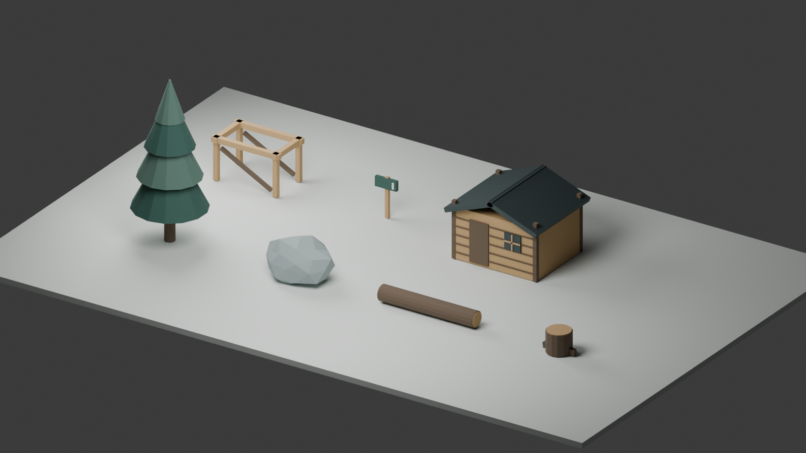

# Quarry Trials — phase 5 framework verification

16 October 2026. The second-biome framework and three local forestry review routes are implemented. **Course/medal fine tuning is deferred by the user. Forestry routes remain pending human review; the final phase-5 quality gate is not claimed. No deployment.**

## Direction and actual approval

The latest user instruction was: “Yes it’s good so far. We can refine the courses later on. I want to make sure we get all framework and game systems implemented before we fine tune.” This approves progressing the six-course quarry/system foundation and overrides the earlier requirement to stop framework work for course/medal refinement. The actual wording and scope are recorded in `phase-4-approval.md` and `scripts/trials/specs/approvals.json`, including the two previously pending quarry hashes. It supplies no physical-controller or audio-listening results and does not approve unseen forestry courses.

At phase-5 implementation time alpine forestry was the stated recommended default. The subsequent user answer on 17 October 2026 explicitly confirmed “Alpine forestry (Recommended)”; the actual ledger now records this direction, separately from pending route approvals. The same QT 250, `qt-250-works-v3` and `qt-physics-3` remain. Quarry geometry, all old record keys, the original asset release and the independent Drift/Pocket games remain intact.

## Local result

- Ordinary six-course quarry game: http://127.0.0.1:8765/trials.html
- Nine-course local review, biome selector: http://127.0.0.1:8765/trials.html?qa=release&course=nursery#game
- Other forestry routes: `?qa=release&course=sawyer#game` and `?qa=release&course=ridge#game`.
- Sustained local QA: `?qa=endurance&review=1&course=nursery#game`.

Run `python scripts/trials/serve.py`. Review autoplay uses retained production witnesses; **Ride manually** enables keyboard/controller play and unlocks audio. QA never writes personal bests. The approved normal game remains Works Line by default. Pending forestry is excluded from the normal challenge picker and static export.

The page has per-biome filtering, progression, course hints and presentation; actual browser thumbnails; the existing three palette-only cosmetics; biome-aware results/next-course selection; and bounded, approved-only challenge selection. Forestry uses granite terraces, root beds, timber crossings, a real empty stream gap, a generous landing and safe ordered checkpoints. These are modest, taught variants of the established six-sector grammar, rather than a new exhaustive procedural vocabulary.

The new Blender kit contains seven original named prototypes: pine, granite, fallen log, stump, timber frame, trail marker and cabin. Headless Blender **4.5.3 LTS**, build `67807e1800cc`, generated the GLB and neutral-lit contact sheet. The kit is **134,808 bytes**; wind/birds ambience is original deterministic eight-second mono PCM, **352,844 bytes**. The biome has its own palette, mountain/snow silhouettes, fog, lighting, soil/timber/rock surfaces and local audio. The bike/rider/rig dimensions are unchanged.



## Contracts and lifecycle

`scripts/trials/forestry.py` validates the biome fields, dimensions, palette, lighting, prototype/budget bounds, shared terrain paths, explicit gap and module contracts. Named `forestry-scenery` and `forest-audio` streams separate cosmetic variation from riding geometry. The actual exported prototype bounds are checked against a conservative 2 m local depth reserve. All 106 authored/scattered instances stay behind the riding/landing sightline corridor. Renderer terrain uses the same source polyline as collision; no runtime road-height repositioning is introduced.

`BiomeCache` verifies lazy-fetched spec/GLB/WAV hashes, parses each biome once, rejects failed loads and permits retry. Cached source meshes stay owned by the cache. Each course owns cloned/batched geometry, materials, textures and instance buffers; switching releases these without disposing the reusable source kit. `disposeTree` now explicitly disposes InstancedMeshes, including their GPU instance buffers. The bike, rider, renderer and engine audio graph are reused. Scene replacement retains the previous course on loading/rebuild failure. Input, interpolation, transient simulation state, event voices and finish cues are cleared on course changes.

Forest ambience decodes after a real gesture, stops/disconnects when leaving the biome, reuses a bounded four-buffer cache, and ignores superseded decode completions. Pause/mute silence the master and ambience. Browser checks observed `ready:true`, a running audio context, one decoded forest buffer, ambience stopped in quarry and restarted in forestry, and no audio error. This verifies lifecycle/decoding, **not the audible mix**.

## Offline composition and evidence

```text
python scripts/trials/build.py biome --seed forestry-01
python scripts/trials/build.py biome-freeze
python scripts/trials/build.py release-stage
```

`--blender` / `BLENDER_PATH` select the exact pinned executable; `--force` regenerates the kit. `biome` writes ignored input-addressed staging, original kit contact sheet, per-route replay/report and SVG trajectory overlay. `biome-freeze` copies compact authoring packages into `scripts/trials/curation/forestry`, outside export; it does not approve them. Real 960×480 thumbnails captured at `?qa=release&course=<id>&shot=1` are frozen beside each route. `release-stage` validates and exposes the local review catalogue. Future promotion requires exact hash-bound human evidence in the actual approval ledger followed by `release`; ordinary export and catalogue rebuild need neither Blender nor search.

Python invokes versioned Node JSON verification using the unchanged production 120 Hz simulation and pinned Planck. Existing complete-route integration witnesses are tried before bounded action search. Limits: 192 MiB Node heap, 20 s verifier time, 350,000 steps, 110 evaluations, 32 action segments, beam width 3; 31 s subprocess timeout; at most two repairs after an initial attempt, with 120 s verification budget for the three-route bank. Blender has a separate 180 s subprocess limit. Failure is `not-validated`, never a proof of impossibility; failed candidates are excluded and the approved quarry Works fallback/pointer remains. No search runs in normal export or gameplay.

| Forestry route | Node time | Perturbations | Evaluations / steps | Browser witness |
| --- | ---: | ---: | ---: | ---: |
| Nursery Trail / beginner | 12.892 s | 9/9 | 10 / 15,452 | 12.89 s / 0 faults |
| Sawyer’s Run / beginner | 13.042 s | 9/9 | 10 / 15,665 | 13.04 s / 0 faults |
| Ridge Return / intermediate | 13.392 s | 8/9 | 10 / 15,889 | 13.49 s / 0 faults |

All succeeded on the initial attempt. The nine retained cases sample baseline, timing ±1%, throttle ±.01, lean ±.015 and initial speed ±.1 m/s, carrying full production state across module joins. Ridge's `throttle-low` case faults at the helmet at 12.208 s; it meets the documented intermediate ≥80% sampled threshold but is not universally robust. Exact tested approach envelopes, camera sightline checks, trajectories and failures are retained in each frozen `report.json` and `phase-5-summary.json`. These samples establish neither human difficulty/fun nor a continuous guarantee across every point in an interval. No new candidate is called human-approved.

Forestry riding identities:

- Nursery: `4504b038d68d155454beef0082a75f144964d3d419a59039276c24459ccf8159`
- Sawyer: `21aa7de4781e29c98081bfbb2374f63b618d028cbee3242930da810572274798`
- Ridge: `db1d61595db0a8d01295b96bbc701d5791978c03e58897307fc02398ca100b10`

## Verification results

**151 tests pass**: 44 Trials JavaScript, 81 Drift/Pocket JavaScript, 18 Trials Python and 8 Drift Python. New checks cover exact frozen witnesses, deterministic geometry/audio, schema/dimension/corridor failures, actual GLB cache reuse/corruption, late audio decode cleanup, 24 alternating biome scene rebuilds including instance-buffer disposal, source-template ownership, record isolation, biome-scoped approved challenges and failed publication retaining the previous pointer. Existing bounded failure/timeout, seam/contact, spawn, retry, pause, controller mapping and static/resource checks continue to pass. Targeted Trials tests were rerun after final selector/disposal changes.

Source and exported static validation pass: **253 local resource references**, no CDN/missing files. Both source/export asset validators confirm the unchanged bike/rider/rig/audio package. Approved and staged catalogue validation additionally reads every fetched course, replay, actual thumbnail, forestry GLB/spec and WAV; hashes, named nodes, topology, PCM format/clipping/loop seam, identities and byte limits pass. Export contains only the current approved quarry catalogue; scripts, previews, caches, local review and pending forestry assets are absent. Superseded catalogue bytes were archived into ignored history.

- Existing asset release: `c1b84012482089ec1b89bf38b87b4bb63a6ee08d3518feb3fc81eb137abc5dbd`.
- Approved six-course catalogue: `3a41b65da93dee528b40827663a4cafcb1d4b948866d30a389cd3bc8c932df9a`: 17 fetched files / **742,274 bytes**.
- Local nine-course review: `dcf19ee068321140370a315cf94315c2e3aa5e262752ead6ce833383f6949c32`: 29 fetched files / **1,664,719 bytes**, exactly three pending routes.

Browser review completed all three forestry witnesses with zero faults, zero reported IK error and no console errors. The selector was exercised across six quarry/three forest cards, pending challenges stayed disabled, cosmetics carried across, and real gesture audio unlocked. Individual screenshots and structured DOM/counter evidence are `phase-5-{nursery,sawyer,ridge}-browser.json`, corresponding JPEGs, `phase-5-selector.jpg` and `phase-5-switch-browser.json`.

## Sustained performance and remaining review

Identified desktop renderer: **NVIDIA GeForce RTX 5080, ANGLE/D3D11, Windows 10 x64, Chromium 155**. Canvas **2558×1334, DPR 1**. A continuous **131.44 riding-second** run completed ten runs across all nine routes and both biomes, with nine switches and zero faults. Average **199.44 FPS**; p95 frame **5.10 ms**, physics **0.10 ms**, render **1.50 ms**; peaks **41 draw calls / 75,138 triangles**. Recent percentile sample window is bounded to 3,600 frames; average covers 26,243 frames / 131.58 measured seconds.

GPU resources plateaued at **52 geometries / 12 textures / 14 shader programs** across both biomes. Forestry returned to 52 geometries / 6 textures, quarry to 49 / 12; shader programs plateau after both materials compile. These are renderer counters, not total JS/process heap measurements or low-end-device evidence. CPU/system-memory querying was unavailable through OS CIM. Full evidence: `phase-5-endurance.json`, `phase-5-endurance.jpg`, `phase-5-summary.json`.


Remaining: human riding/art review of the three forestry routes before promotion, later course/medal refinement, actual physical-controller and audio-listening feedback, and lower-tier/mobile hardware QA. The framework work is delivered under the user's explicit sequencing preference; these are not grounds to pretend approval or stop independent phase-6 framework work. No new handling class, mobile controls, online service, editor or deployment was added. Exact next instruction: [phase-6-prompt.md](phase-6-prompt.md).
