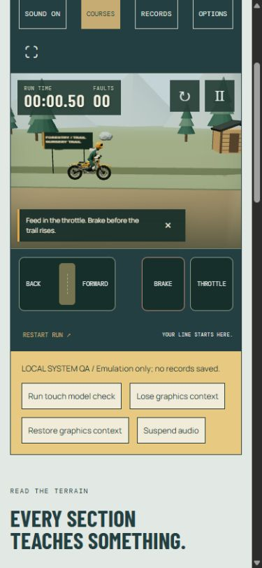

# Quarry Trials — phase 6 verification

17 October 2026. **Mobile and release-hardening framework implemented locally; physical-device quality gates remain open. No deployment or pending-course promotion.** Course/medal fine tuning stays deferred under the user's framework-first instruction. Alpine forestry direction is now explicitly confirmed by “Alpine forestry (Recommended)”; its three riding routes still need individual human review.

## Local result and commands

The active review server uses port **8766** in this session. The server's default remains 8765; either port can be selected explicitly. Storage belongs to the browser origin, so different local ports have separate bests without deleting either store.

```text
python scripts/trials/serve.py --port 8766
```

- Ordinary six-course quarry game: http://127.0.0.1:8766/trials.html
- Forestry/system QA: http://127.0.0.1:8766/trials.html?qa=hardening&review=1&course=nursery&touch=1#game
- Approved-only system QA: `?qa=hardening&touch=1#game`
- Detail-tier/biome endurance: `?qa=endurance&review=1&course=nursery&cycle=1#game`
- Fixed low-tier endurance: `?qa=endurance&review=1&course=nursery&quality=low&touch=1#game`

QA is local-only, never saves records and uses production input/physics/rendering. `review=1` loads the existing staged bank, not a runtime generator. `quality=high|balanced|low` is a local QA override; Options provides normal persistent settings. `touch=1` forces the control strip for desktop emulation. Run touch model check exercises two seconds of the real channel model and simulation; its diagnostics explicitly distinguish this from native multi-touch hardware. Lose/Restore graphics context uses `WEBGL_lose_context`, and Suspend audio tests actual Web Audio interruption.

## Implemented systems

Three analog touch channels have independent pointer ownership. Throttle/brake use vertical travel; lean uses horizontal travel with a neutral dead zone. Pointer capture retains control outside the pad, and up/cancel/lost-capture releases its channel. A second pointer cannot steal an occupied channel. Controls sit in a separate strip below the scene, with right/left pedal layout. Sliders have names, value ranges, current values, disabled state, focus styling and keyboard arrows/Home/End; releasing keyboard input returns to neutral.

Touch, keyboard and standard-controller input merge through `TrialsInput`. Pedals take the strongest active value; keyboard lean takes priority, otherwise the stronger touch/stick lean wins. Reset, retry, course/biome changes, modal, blur, hidden page, orientation, resize and disconnect clear every touch channel and capture as well as keyboard/gamepad transient state. Controller input must return to neutral. Editable UI and normal dialog/button interaction cannot issue riding shortcuts; the crash dialog deliberately retains R/Backspace retry/restart. Pointer controls stay disabled while paused or loading.

Responsive layout covers a 390×844 portrait override and an 844×390 landscape override, safe-area CSS, dynamic viewport units, scrollable dialogs, compact HUD, 44 px UI targets and the separate control strip. Desktop page presentation is retained. Camera tests retain take-off/landing in the horizontal frustum at aspect ratios .75, 1.3, 1.95 and 3.2 without changing the camera source/physics contract. Native mobile browser chrome, notches and fullscreen behaviour remain physical-device checks; desktop fullscreen can escape a viewport override and is not treated as phone evidence.

Options adds bounded persistent automatic/high/balanced/low graphics, touch visibility and pedal handedness. Automatic chooses low for coarse-pointer or narrow devices and high for ordinary desktop. Pixel ratio is capped at **1.5 / 1.25 / 1**; shadows use **2048 / 1024 / off**. Stable decorative subsampling reduces forest trees/rocks, quarry benches and distant seams; all riding surfaces, supports, signs, safe checkpoints, bike/rider sockets and handling remain identical. Tier changes replace/dispose environment-owned resources transactionally while reusing source kits, bike/rider and simulation. Shadow render targets are also released when changing tier and on final disposal.



## Recovery, resources and storage

`GraphicsRecovery` pauses and clears input/audio on context loss, cancels pending scene replacement and stops rendering into the lost context. Three's restored renderer recompiles/reuploads the retained scene; the existing simulation remains paused. The player resumes deliberately. Stale restoration completion cannot override a later loss; restoration failure retains a reload path. The actual desktop loss/restore test preserved **exact pose, elapsed time and tick count**, with all touch values neutral. Evidence: `phase-6-context-browser.json`.

Web Audio suspension pauses riding and silences output. A real Resume gesture resumes the same audio graph and decoded ambience. Delayed prepare/decode completion cannot create sources after disposal or reinstate a departed biome. Browser evidence records suspended → running, one forest ambience buffer and no error in `phase-6-audio-browser.json`. Audible mix/listening is not claimed.

`resourceBytes` bounds the entire fetch/body read to 15 seconds and 2 MB, streaming with an early size rejection and aborting on every exit. Asset pointer/manifest reads have a 100 KB cap. Runtime asset manifest identity is recomputed from canonical files/input hash, each resource remains checksum-verified, and unavailable integrity support fails closed. A broken asset pointer/manifest may select only the exact immutable known-good asset release. Missing/corrupt resources still fail visibly; partial GLB loads are disposed. Try again retries preparation without accumulating panels/assets, while Use Works Line leaves review mode for the ordinary curated fallback. Catalogue failure retains Works; failed course replacement keeps the previous run.

Records retain their existing bounded forty-entry store and riding/physics/bike keys. Reads reject oversized (>64 KiB) data before JSON parsing; preferences have a 4 KiB read bound and strict setting enums. Failed writes keep this visit's records/preferences in memory. No existing record namespace or course/physics identity changed.

## Tests and static export

**160 tests passed**: 53 Trials JavaScript, 81 Drift/Pocket JavaScript, 18 Trials Python and 8 Drift Python. Nine new tests cover multi-pointer ownership/clamping/cancellation, DOM capture/reset/keyboard semantics, controller/keyboard coexistence and interruption cleanup, exact production touch replay, context freeze/failed/stale restore, body-read deadlines/size/corrupt manifest, immutable fallback loading, repeated actual biome/tier geometry disposal/cost and narrow camera framing, and oversized/write-failed storage. Existing suspension, seam/contact, landing, fault/retry/timer, rig, course-bank/timeout and record regressions continue to pass. Targeted Trials checks were repeated after the final input/recovery changes.

```text
node --test tests/trials/*.test.mjs tests/drift/*.test.mjs tests/pocket/*.test.mjs
python -m unittest discover -s tests/trials -p "test_*.py"
python -m unittest discover -s tests/drift -p "test_*.py"
python scripts/validate_static_assets.py
python scripts/trials/build.py validate
python scripts/trials/build.py release-validate
python scripts/drift/build_static.py
python scripts/validate_static_assets.py dist
python scripts/trials/build.py validate --site-root dist
python scripts/trials/build.py release-validate --site-root dist
```

Source/export validation passes for **263 local references**, with no CDN/missing resources. Asset validation reads the actual fetched GLBs/rig/specs/sounds; approved and staged catalogue validation additionally checks course/replay/thumbnail and forestry GLB/spec/WAV hashes, topology, PCM and byte budgets. The normal export includes only the six approved quarry courses, retaining Works as default/fallback; pending forestry, curation/scripts, tools, caches, docs and large diagnostics are absent. Ordinary export invoked neither Blender nor search. `dist` is the concrete reviewed local export; `phase-6-export.json` records its fingerprint and resource counts.

Identities remain:

- Asset release: `c1b84012482089ec1b89bf38b87b4bb63a6ee08d3518feb3fc81eb137abc5dbd`.
- Approved catalogue: `3a41b65da93dee528b40827663a4cafcb1d4b948866d30a389cd3bc8c932df9a`.
- Local review catalogue: `dcf19ee068321140370a315cf94315c2e3aa5e262752ead6ce833383f6949c32`.
- Original Works riding geometry: `9d0386a46f7378211941a5a5b4be2f264a214bf419e38e3e47b912c0060a99bd`.
- QT 250 / `qt-250-works-v3`, `qt-physics-3`, pinned Three 0.180.0 / Planck 1.4.2, Python/headless-Blender 4.5.3 pipeline retained.

## Browser/performance evidence

Reference desktop: **AMD Ryzen 7 9800X3D, NVIDIA RTX 5080 (ANGLE/D3D11), Windows x64, Chromium 155, DPR 1**. Responsive overrides run on that desktop; they are not physical-phone benchmarks. Each sustained run completed ten zero-fault runs across all nine routes, including a return to forestry, over **131.44 riding seconds** and nine course changes.

| Capture | Canvas | Average FPS | p95 frame / physics / render | Peaks: draw calls / triangles | Resource maxima |
| --- | --- | ---: | --- | --- | --- |
| Desktop, cycling all tiers | 1162×550 | 199.45 | 5.10 / .10 / 1.50 ms | 41 / 75,174 | 52 geometries / 12 textures / 21 programs |
| Small viewport, fixed low | 761×400 | 199.61 | 5.10 / .10 / 1.30 ms | 41 / 45,458 | 52 geometries / 11 textures / 5 programs |

Per-route renders were reviewed at all three tiers in both biomes. The cycling run's forest peaks reduced from 75,174 triangles (high) to 55,566 (balanced) and 45,510 (low); quarry from 49,774 to 43,774 to 39,914. Course finish times and faults stayed unchanged. The shader cache warms up for both shadow/material variants, then plateaus; a low-only run stays at five programs. Source-kit cache ownership, instance-buffer/texture/material/skeleton disposal and repeated resource counts are also covered by unit tests.

Low-run Chromium JS heap samples ranged **20.58–49.73 MiB**, from **36.36 MiB** at first route finish to **26.42 MiB** on returning to Nursery. GC was not forced; sampled heap and renderer counters are not complete process/VRAM measurements or proof of long-term device thermal stability. FPS totals cover ~26,200 frames / 131.4 seconds; percentile windows are bounded to the last 3,600 samples.

Machine-readable evidence: `phase-6-summary.json`, `phase-6-endurance-desktop.json`, `phase-6-endurance-low.json`, `phase-6-tiers-browser.json`, `phase-6-pointer-browser.json`, `phase-6-touch-model.json`, context/audio JSON and portrait/options/course-board/landscape captures. Actual desktop pointer input captured once and released with no held owner; native simultaneous fingers remain untested. A deliberately unknown local review course was rejected, Try again rejected it cleanly a second time, and Use Works Line returned to the exact original riding hash (`phase-6-error-browser.json`). Expected caught error messages from this deliberate failure are separate from the clean successful QA runs. Fresh resumed QA produced no console errors. An initial missing loading-button hook was corrected before these final captures.

## Remaining gates

The framework is delivered; **fully hardened release/device approval is not claimed**. Real phone/tablet multi-touch, Safari/Android audio/background/orientation/safe areas/fullscreen, lower-tier thermal/frame/memory behaviour, physical-controller feel/disconnect and actual listening remain untested. The three forestry routes still need explicit human approval before ordinary promotion; medals/art/course refinement remain deferred rather than blocking independent systems. No additional biome, handling class, service, editor or deployment was added. The actionable next checks are in [release-readiness.md](release-readiness.md).
